<p align="center">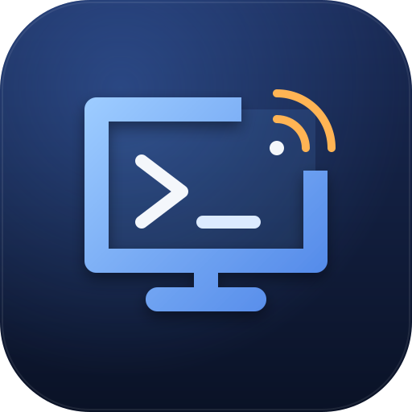</p>

# Remotething

One window for all your remote connections: SSH terminals, RDP and VNC desktops, file transfers, and shells on your own machine, organised in a single tree. Free software (GPL-3.0) for Linux and Windows, written in Rust. In development, not yet 1.0.

<p align="center">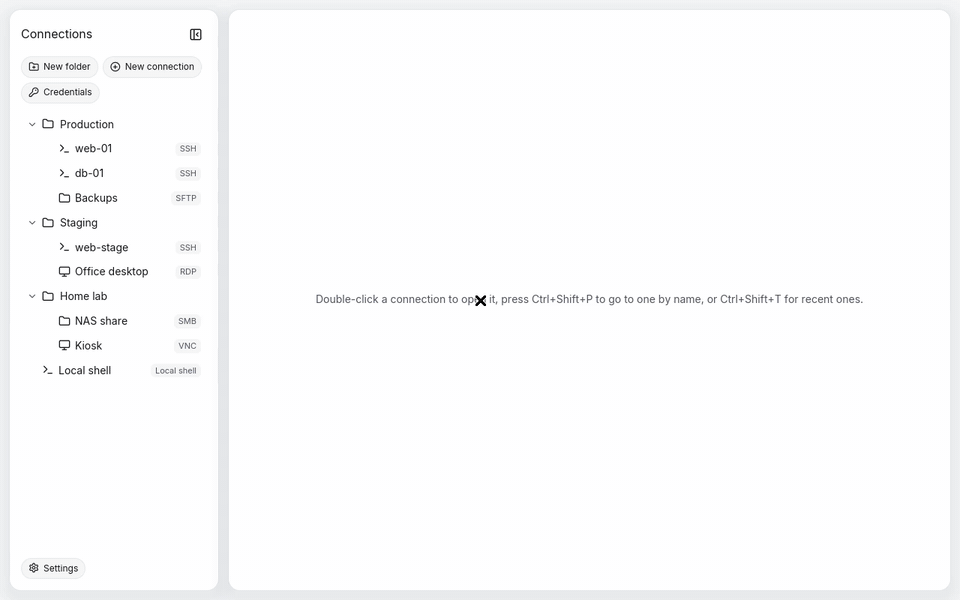</p>

## Features

### One tree for everything

- **Folders and connections** in a tree you can drag around. Settings (port, credential, jump host, forwards, quality) are inherited from the folder, so you set them once.
- **A plain TOML file** you can back up, diff and keep in git. Passwords are never in it; they live in the system keyring, or in an encrypted file when there is no keyring.
- **Imports** from PuTTY and from WSL, and export and import of your own tree.
- **Command palette** (Ctrl+Shift+P) to open anything by name, and a connection-string box: type `ssh ops@web-01` or `rdp://desk` and go.
- **Asks before it removes** a connection, folder or credential, and before it closes a live session.

<p align="center">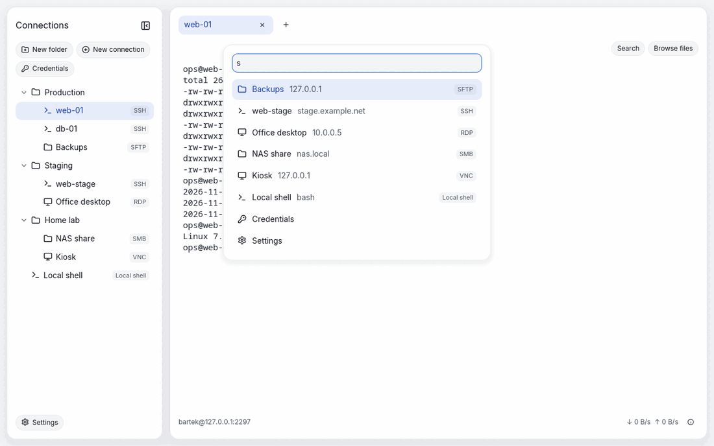 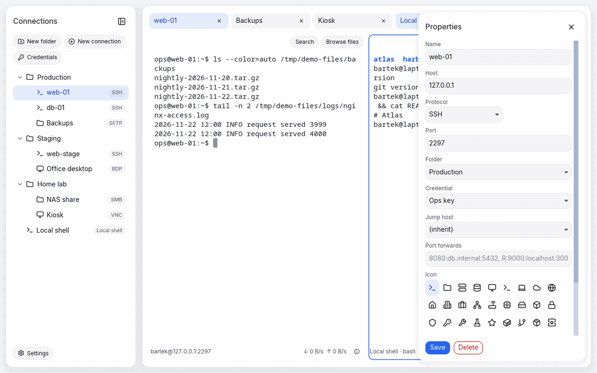</p>

### SSH terminals

- **A real terminal** (the engine of Alacritty): 256 colours and true colour, mouse support for tmux, herdr and friends, copy and paste, clipboard from remote programs (OSC 52), colour themes you can import, your choice of font and size.
- **Search** the scrollback, across wrapped lines.
- **Sign in** with passwords, key files, ssh-agent or keyboard-interactive prompts.
- **Jump hosts**, chained, and **port forwards**: local, remote and dynamic (SOCKS5).
- **Host keys** checked against your known hosts, with the fingerprint shown on first contact. OpenSSH host certificates are understood too.
- **Screenshots and recordings** of a terminal, off until you switch them on.

<p align="center">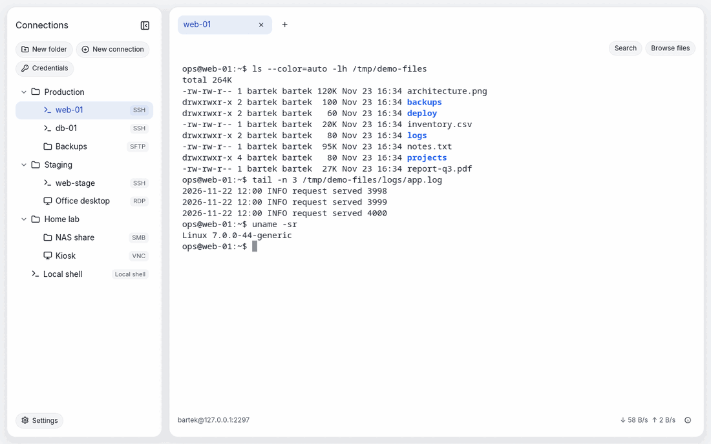 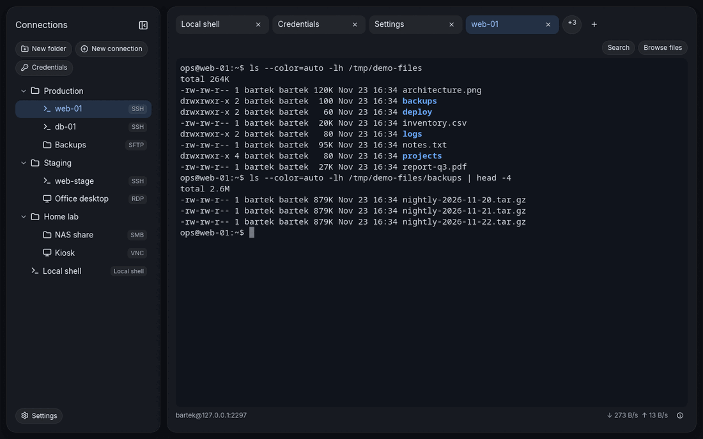</p>

### Files

- **Browse and transfer** over SFTP (SCP when the server has none), FTP and FTPS, SMB shares and NFS (experimental), beside a terminal or on their own.
- **Two panes**, the server and this computer, with a transfer queue, preview, drag and drop and keyboard control.

<p align="center">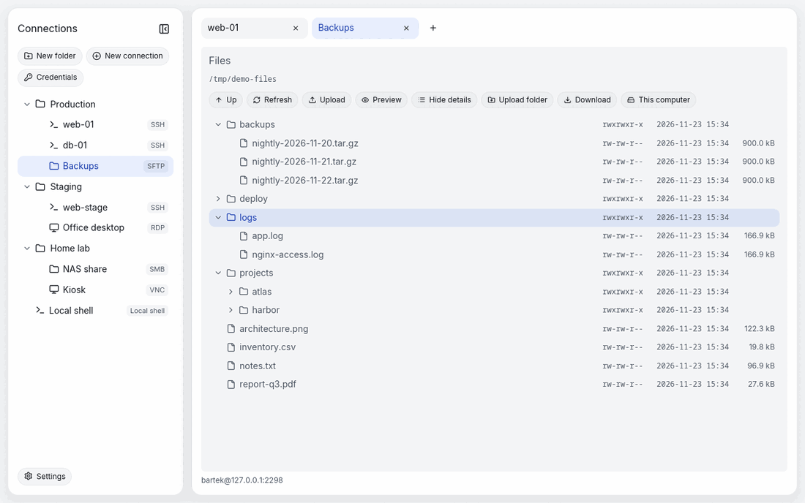</p>

### Remote desktops

- **RDP** with resizing, clipboard (text, images and files), quality presets and server certificate checks.
- **VNC** with clipboard and quality presets, and a note that VNC is not encrypted unless you tunnel it.
- **Recordings and screenshots** of a desktop, off until you switch them on.

<p align="center">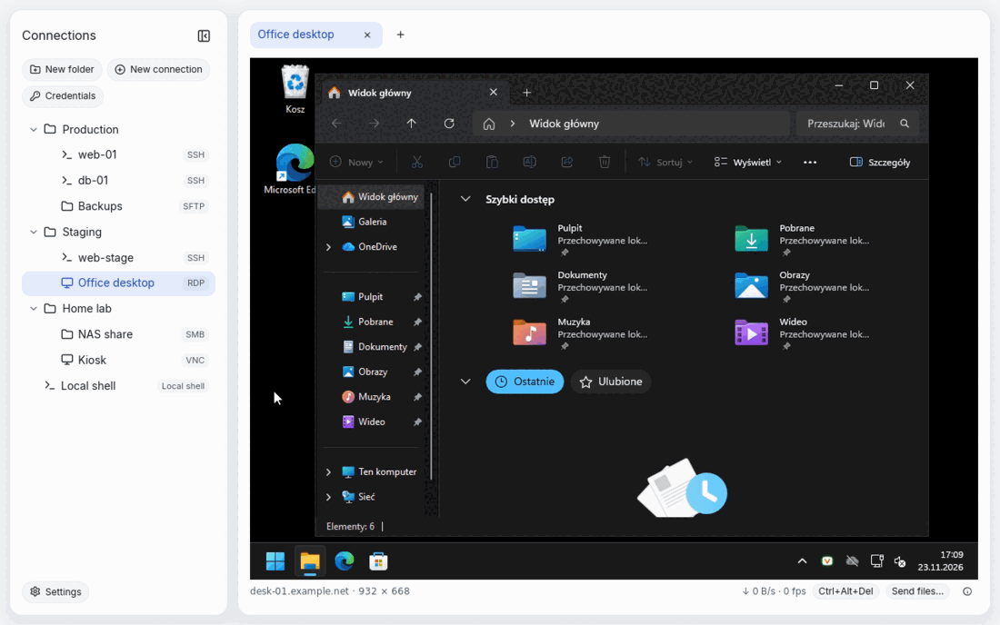 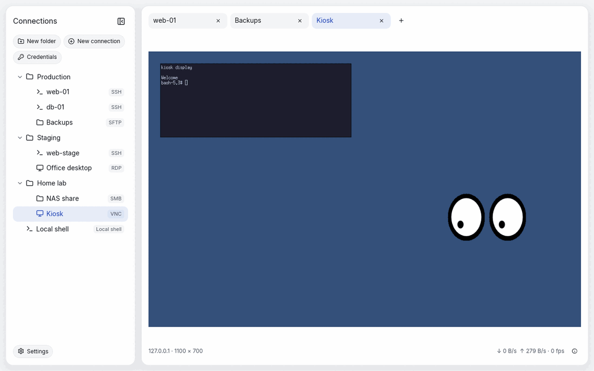</p>

### Local shells

- **New local terminal** (Ctrl+Shift+L) opens your shell in a tab, with nothing to set up.
- **Saved local shells** choose the program (bash, zsh, fish, pwsh, tmux, herdr, anything on your path), its arguments, the folder it starts in and its environment variables.
- **WSL distributions** on Windows open the way Windows Terminal does.

### Tabs and layout

- **Everything is a tab**, including Credentials and Settings. Drag tabs to reorder them; a silhouette follows the pointer.
- **Split view** puts two tabs side by side or stacked, with a draggable divider.
- **Keyboard first**: a shortcut for each of these, listed under F1.
- **Light, dark and high-contrast** themes, interface scaling, and keyboard access to everything (screen readers are not supported yet).

<p align="center">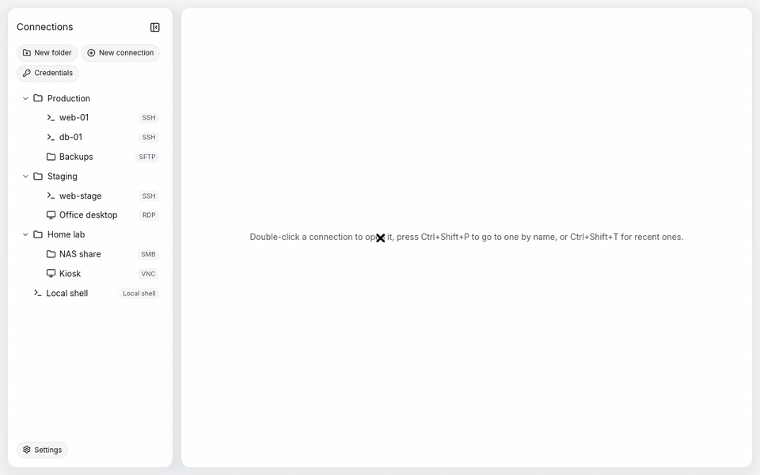 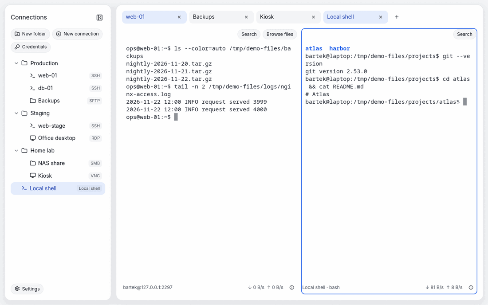</p>

## Install

| System | How |
| --- | --- |
| Ubuntu or Kubuntu 26.04 and later | `sudo apt install ./remotething_<version>_amd64.deb` |
| Fedora and other RPM systems | `sudo dnf install ./remotething-<version>.x86_64.rpm` |
| Any Linux with Flatpak | `flatpak install --user remotething-<version>.flatpak` |
| Windows 10 and 11, 64-bit | run `remotething-<version>-windows-x86_64-setup.exe` (or unzip `remotething-<version>-windows-x86_64.zip` and run `remotething.exe`) |

Linux packages are built with `cargo xtask package linux` and `cargo xtask package flatpak` (they land in `dist/`); CI builds the Windows zip for every merge to `main`. The Windows program is not code-signed yet. The [installing guide](docs/src/installing.md) has the details.

Or build and run from source with a current Rust toolchain:

```sh
cargo run --release -p remotething
```

## Documentation

- [User guide](docs/src/introduction.md) (`mdbook build docs` builds it as a site)
- [Keyboard shortcuts](docs/src/shortcuts.md) and [troubleshooting](docs/src/troubleshooting.md)
- [Architecture](ARCHITECTURE.md) and [contributing](CONTRIBUTING.md)
- [Changelog](CHANGELOG.md)

## License

GNU General Public License, version 3 only; see [LICENSE](LICENSE). Bundled fonts and icons keep their own licences, listed in [NOTICE](NOTICE).
