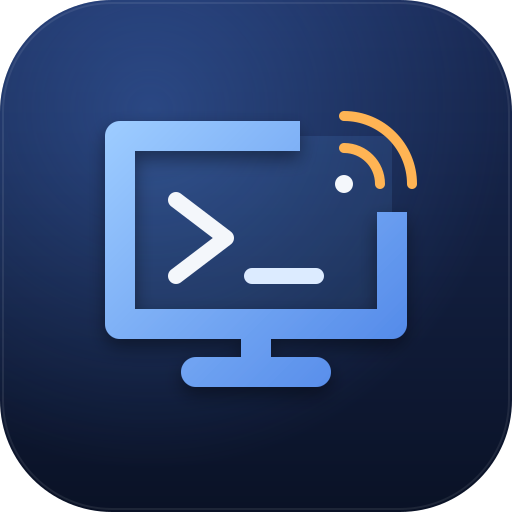

# Introduction

Remotething is a desktop app for remote connections: RDP and VNC desktops, SSH terminals and file transfers, organised in one tree.

It is in early development. This guide grows with each release; today it covers installing, starting the app and the connections file.
