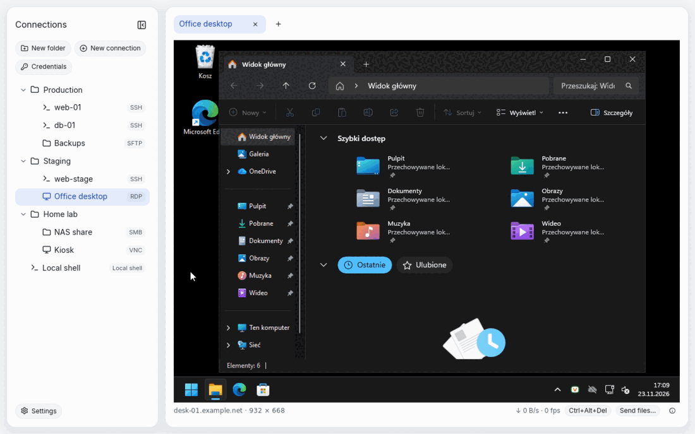

# Remote Desktop

Double-click a connection whose protocol is **RDP**. A tab opens and the Windows desktop appears in it.

## Signing in

| Credential | What happens |
| --- | --- |
| None | The tab asks for a user name and a password |
| Password | The stored password is used; if none is stored, the tab asks for it |
| Ask every time | The tab asks for the password on every connect |

The credential's **Domain** field is sent with the user name. SSH-only credentials (key, ssh-agent, keyboard-interactive) cannot be used for RDP; the tab says so.

The connection uses Network Level Authentication (NLA), so the server checks the password before it shows a desktop. If the server refuses the password, the form comes back.

## Server certificates

Windows servers present their own certificate. The first time you connect to a host, the tab shows its fingerprint and asks you to trust it; nothing secret has been sent yet. The fingerprint is remembered per host and port in `known_hosts.toml` next to the connections file.

If the certificate later changes, the tab warns before sending anything. Trust the new one only if you expected the change, for example after a reinstall.

## Using the desktop

- The remote desktop follows the size of the tab: about a second after you stop resizing the window or the tree, the server is asked for a desktop of that size. It starts at 1280 x 800 and is asked to resize about two seconds after connecting. Until the new size arrives the picture is scaled to fit.
- On a screen with display scaling (for example 150 %) the desktop is asked for in real screen pixels, and Windows is told the scaling, so its text and icons have the size you expect and the picture is sharp. Moving the window to a screen with another scaling changes it.
- The mouse works as on the remote machine: move, the three buttons and the wheel. The pointer you see is the remote machine's own, so it changes to a text cursor, resize arrows, a busy ring and so on as Windows asks. Until the server sends one, your system's arrow shows.
- Keys are sent by their position on the keyboard, so the remote keyboard layout decides which character appears. Everything is sent except the app's own tab keys: **Ctrl+Shift+T**, **Ctrl+Shift+W**, **Ctrl+Shift+P** (palette), **Ctrl+Tab**, **Ctrl+Shift+Tab** and **Alt+1** to **Alt+9**. **Ctrl+W** goes to the remote machine.
- **Clipboard:** text and pictures are shared both ways. Whatever you copy on the remote machine appears on your clipboard, and text or a picture on your clipboard can be pasted there. Your clipboard is looked at once per second, and only while this tab is in front and connected; then its content is offered to the server. If the remote machine copied both text and a picture, only the text is taken.
- **Files** go both ways through the same channel, as copy and paste on the remote desktop:
  - **To the remote desktop:** copy files in your file manager (Ctrl+C in Dolphin, Explorer or Finder) while the tab is in front, press **Send files…** and pick files, or drop files and folders on the window (Windows, macOS and X11; not native Wayland). The first two work everywhere. The strip says **N files (size) ready to paste** and keeps saying it until you paste them or copy something else; paste them on the remote desktop in Explorer. Nothing is copied until you paste.
  - **From the remote desktop:** copy files there. The strip says **N files copied remotely** and offers **Receive (N)**; pick a folder to save them into. A progress bar and figure show above and in the strip, and **Cancel** stops it. Sending shows only a figure, because Windows paces and shows the paste itself.
  - **Safety:** nothing is ever replaced; if a name is taken, nothing is received and the strip says which one. Names from the server that would write outside the folder you picked are refused, and links are not followed. Sending skips links and special files, and refuses names Windows cannot hold.
  - A new copy on either side replaces the previous one, and copying text or a picture offers that instead of the files.
- **Ctrl+Alt+Del** cannot be typed, because your own system takes it. The **Ctrl+Alt+Del** button in the strip under the desktop sends it to the remote machine and opens Windows' security screen. Press Escape or choose Cancel there to leave it.
- Closing the tab ends the session and asks first.
- If the connection breaks on the way, the tab connects again by itself, up to three times in a row, and Windows gives back the same desktop. The last picture stays on screen, the strip says the connection was lost, and a recording, the clipboard and your window size carry on; only a second or two of input is lost. This happens now and then on Windows 11 when the desktop changes size: the server skips one piece of the encrypted stream and everything after it fails to decrypt (`cannot decrypt peer's message`). A session that ends for another reason shows why, with a **Reconnect** button.

## Quality

Choose **Remote desktop quality** in the properties panel of a connection, or of a folder for everything inside it. The same setting applies to [VNC](vnc.md#quality). Without a choice the connection uses **Balanced**.

| Preset | Colours | What the server skips | Data in the first 8 seconds of an idle Windows 11 desktop |
| --- | --- | --- | --- |
| Best picture (fast network) | 32 bit | Nothing: wallpaper, window animations and desktop composition stay on | about 1.2 MB |
| Balanced | 32 bit | Wallpaper, menu animations, window contents while dragging | about 0.18 MB |
| Low bandwidth | 16 bit | The same, and visual themes, cursor shadow and cursor settings | about 0.13 MB |

All presets offer the RemoteFX codec, which the server uses when it can. A change applies the next time you connect.

## Connection details

A strip under the desktop shows the host, the desktop size and the current download rate and frames per second. The **(i)** button at its right end opens a panel with:

| Line | Meaning |
| --- | --- |
| Address | The IP address and port actually connected to |
| Security | How the connection is secured |
| Quality preset | The preset this connection uses |
| Picture codec | What the client offers: RemoteFX, with classic bitmaps as the fallback |
| Desktop size | Pixels of the remote desktop |
| Receiving, Received in total | Current rate and total of RDP data received, without TLS overhead |
| Frames per second | Pictures shown per second, at most 30 |
| Connected for | Time since the session started |

The rates appear after the first second and update once per second. The same strip will serve VNC.

## Not available yet

| Feature | State |
| --- | --- |
| Kerberos sign-in, RD Gateway, audio, drive redirection | Not planned for now |
