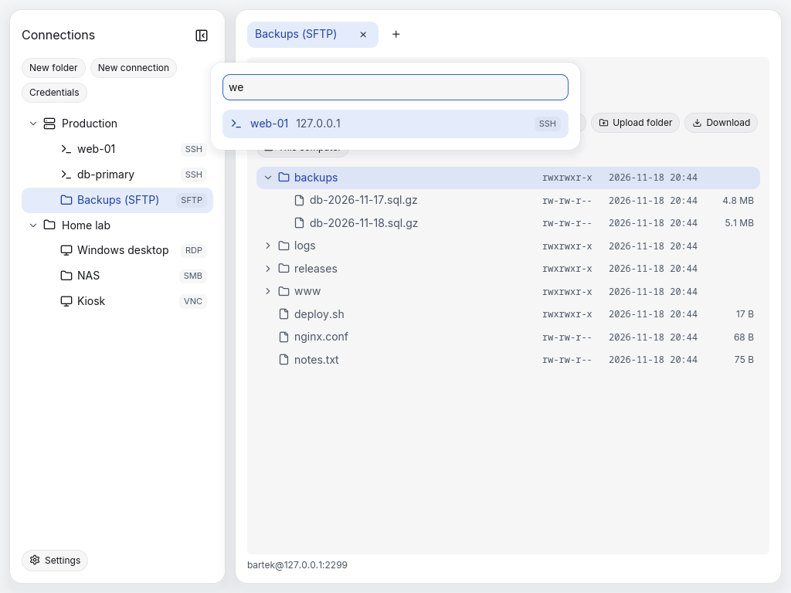

# Keyboard shortcuts

**F1** shows this list in the app, also over a remote desktop.

| Keys | What it does |
| --- | --- |
| **Ctrl+Shift+P** | Go to a connection or an action (the command palette) |
| **Ctrl+Shift+T** | New tab, listing recent connections |
| **Ctrl+Shift+W** | Close the tab in front. **Ctrl+W** does the same, except while a terminal has the keyboard |
| **Ctrl+Tab**, **Ctrl+Shift+Tab** | Next and previous tab |
| **Alt+1** to **Alt+9** | Tab by number; 9 is the last |
| **Ctrl+Shift+S** | Split the view, or go back to one tab |
| **Ctrl+Shift+O** | Give the keyboard to the other pane |
| **Ctrl+Shift+R** | Stack or unstack the split panes |
| **Ctrl+Plus**, **Ctrl+Minus** | Terminal text size (also **Ctrl** with the mouse wheel) |
| **Ctrl+F** | Search |
| **Tab**, **Shift+Tab** | Move between the fields of a form |
| **Esc** | Close a panel, menu or box |

## In a terminal

| Keys | What it does |
| --- | --- |
| **Shift+Page Up**, **Shift+Page Down** | Look back through the output |
| **Ctrl+Shift+C** | Copy the selection |
| Middle click | Paste the selection (Linux) |

## In a file browser

| Keys | What it does |
| --- | --- |
| Arrow keys, **Enter** | Move, open and fold folders |
| **Tab** | Switch between the two panes |
| **F2**, **Delete**, **F5** | Rename, delete, refresh |

Over a remote desktop every key goes to the remote machine, except the app's own tab and split shortcuts.
