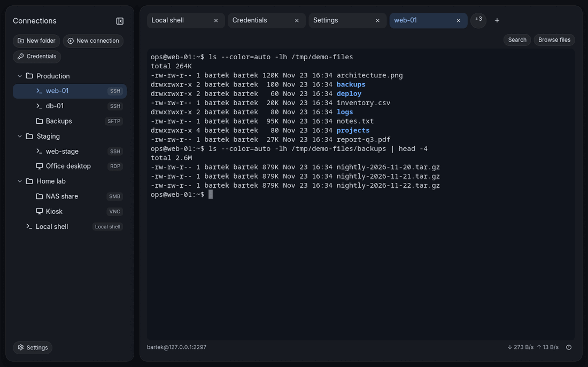
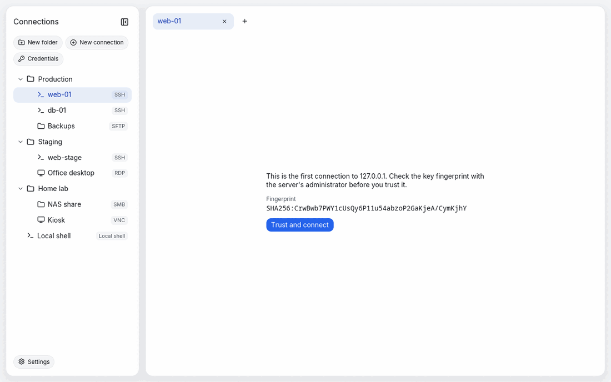
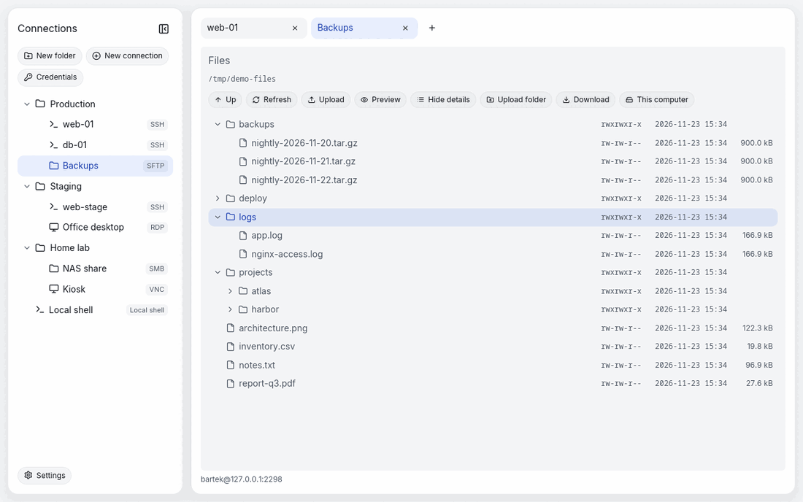

# SSH

Double-click an SSH connection, or right-click it and choose **Connect**. A tab opens with a terminal.



## Signing in

What the app asks for depends on the connection's credential:

| Credential | What happens |
| --- | --- |
| None | The tab asks for a user name and a password |
| Password | The stored password is used; if none is stored, the tab asks for it |
| ssh-agent | The keys of your running ssh-agent are tried in turn; nothing is typed or stored |
| Keyboard-interactive | The server's questions (password, one-time code) are shown in the tab on every connect; nothing is stored |
| Private key | The key file (OpenSSH, PEM or PuTTY `.ppk`) is used; if it is encrypted and no passphrase is stored, the tab asks for it |
| Ask every time | The tab asks for the password on every connect |

**ssh-agent** works with `ssh-agent` or any compatible agent (GNOME Keyring, KeePassXC, 1Password) through `SSH_AUTH_SOCK` on Linux. On Windows it uses the OpenSSH agent service, then Pageant. The credential needs a user name; the agent signs, so the private keys never reach this app. Add keys with `ssh-add`.

**Keyboard-interactive** is for servers that use two-factor sign-in (PAM with a one-time code). The credential needs a user name. Hidden answers are masked. It does not work for jump hosts, and there is no time limit while you type.

A password typed into the tab is used for that session only. To store one, use the **Credentials** screen.

If the server refuses a password, the form comes back so you can try again. If it refuses a key, the tab says so; fix the credential and press **Reconnect**.

## Jump hosts

A connection, or a folder above it, can name another connection as its **Jump host** in the properties panel. The app connects to the jump host first and reaches the target through it; jump hosts can be chained, each with its own jump host.

- Every server on the way has its host key checked, and the question names the server it is about. Trust each in turn.
- A jump host needs a credential. With a stored password, a key file (its passphrase, if any, stored too) or an agent it connects by itself. With **Ask every time** the tab first asks for that jump host's password (and user name, if the credential has none), one form per jump host, then goes on. A refused password ends the tab with the host's name; **Reconnect** asks again. Keyboard-interactive credentials do not work on jump hosts. VNC tabs cannot ask, so a jump host used by VNC needs a stored password.
- The jump host's SSH server must allow forwarding (`AllowTcpForwarding yes`, the OpenSSH default). If it does not, the tab says which host refused.
- The connections to the jump hosts stay open as long as the session does, and close with it.

## Port forwards

The **Port forwards** field of a connection, or of a folder above it, lists forwards, separated by commas. There are three kinds:

| Write | Like | What it does |
| --- | --- | --- |
| `8080:db.internal:5432` | `ssh -L` | Listens on this machine's port 8080 and reaches `db.internal:5432` as the server sees it |
| `R:9000:localhost:3000` | `ssh -R` | The server listens on its port 9000 and reaches `localhost:3000` as this machine sees it |
| `D:1080` | `ssh -D` | Listens on this machine's port 1080 as a SOCKS5 proxy; whatever connects through it leaves from the server |


- The forwards open when the session connects and close with the tab.
- They listen on `127.0.0.1` only, so only this machine (or, for `R:`, only the server itself) can use them.
- The SOCKS5 proxy has no sign-in and supports `CONNECT` (TCP) only.
- A server that does not allow remote forwards (`AllowTcpForwarding`, `GatewayPorts` rules) refuses an `R:` forward; the tab says so in red.
- A port that is already in use is shown in red above the terminal; the other forwards still open.
- A connection with its own list ignores the folder's; leave it empty to inherit.

## Host keys

The first time you connect to a host, nothing is sent to it yet. The tab shows the fingerprint of the server's key:

1. Compare the fingerprint with the one the server's administrator gives you.
2. Press **Trust and connect**. To refuse, close the tab.



Trusted keys are kept in `known_hosts.toml`, beside the connections file, by host and port.

If a trusted host later shows a different key, the tab warns you before anything is sent. This happens when a server is reinstalled, and also when someone intercepts the connection. Trust the new key only if you know why it changed.

### Host certificates

A fleet signed by a certificate authority needs no question per server. Remotething reads the `@cert-authority` lines of OpenSSH's `~/.ssh/known_hosts` (on Windows, `%USERPROFILE%\.ssh\known_hosts`), so the same line serves `ssh` and Remotething:

```text
@cert-authority *.example.net ssh-ed25519 AAAA...
```

A server the pattern covers presents its certificate, and the tab connects when it is a host certificate for that name, signed by that authority and within its dates. A certificate that fails these checks is refused with the reason. Servers no pattern covers behave as before, with the fingerprint question. Patterns take `*`, `?` and `!` to exclude; a port other than 22 is written `[host]:port`.

## The terminal

- 16, 256 and true colours, bold and underline. The colours follow the app's light or dark theme.
- **Ctrl+Plus** and **Ctrl+Minus**, or **Ctrl** with the mouse wheel, change the text size of terminals. **Settings → Terminal** sets the text size (10 to 24 pt) and the colour theme. Open terminals change at once. The font is the bundled Noto Sans Mono unless you type the name of an installed monospace font there and press Enter; a name that is not installed falls back to the system's choice. Fonts about 0.6 em wide, like most, line up best.
- The terminal resizes with the window, and the remote programs are told.
- The mouse wheel, or **Shift+Page Up** and **Shift+Page Down**, looks back through up to 10,000 lines. Typing returns to the newest line.
- Programs that use the mouse, such as tmux, htop or midnight commander, get clicks, drags and the wheel. Hold **Shift** to select text yourself instead. In full-screen programs that do not use the mouse, such as less, the wheel moves with the arrow keys.
- Drag over text to select it. Double-click selects a word and triple-click a line; dragging after that grows the selection by words or lines. On Linux the selection is copied at once for middle-click paste; **Ctrl+Shift+C** copies it to the clipboard.
- The **Search** button above the terminal, or **Ctrl+Shift+F**, opens a search bar. It finds text on the screen and in the scrollback, ignoring letter case, and highlights every match; the one you are on is brighter. Enter or the arrows step through the matches, starting from the newest, and Escape closes the bar. New output from the server clears the highlights; press Enter to search again. A phrase that the terminal wrapped onto the next line is found too.
- **Ctrl+Shift+V** pastes from the clipboard. A middle click pastes what was last selected.
- A paste with a line break or another control character, or longer than 2,000 characters, asks first and shows its size and first lines. Enter pastes, Escape cancels. Line breaks are sent as Enter. Control characters other than tab and line breaks are removed from pasted text.
- Programs that ask for it (most shells and editors) are told that the text is a paste, so they do not run or indent it as if it was typed.
- A closed session shows why it ended and a **Reconnect** button. Closing the tab closes the connection.
- A keepalive is sent every 30 seconds so idle sessions are not dropped by firewalls.

### Colour themes

In **Settings → Terminal**, press **Import theme file…** and pick a theme of Alacritty (`.toml`, or the older `.yml`), kitty (`.conf`) or Ghostty (a file with `palette = N=#rrggbb` lines). The theme is saved in `terminal-themes.toml` beside the settings and shows in the list. Click a theme to see it in the preview box, which draws a made-up `fastfetch` screen in its colours; **Use this theme** applies it, a ✓ marks the one in use, and **Delete** removes it. **Default** follows the app's light or dark theme.

- A theme needs a foreground, a background and some of the 16 colours; the ones it leaves out come from the default palette.
- Colours other than these (cursor, tabs and so on) are ignored.

## Connection details

A strip under the terminal shows `user@host:port` and the current download and upload rates. The **(i)** button at its right end opens a panel with:

| Line | Meaning |
| --- | --- |
| Address | The IP address and port connected to, or the jump hosts the connection goes through |
| User name, Sign-in | The account, and how you signed in: password, key file, ssh-agent or keyboard-interactive |
| Server software | How the server calls itself, for example `SSH-2.0-OpenSSH_9.6` |
| Host key type, fingerprint | The key the server proved itself with, as you trusted it |
| Terminal size | Columns and lines |
| Port forwards | The forwards that are open, when there are any |
| Received, Sent | Bytes of shell data so far, with the current rate. Files and forwards are not counted |
| Connected for | Time since the shell opened |

Rates update once per second. The same strip is used by [Remote Desktop](rdp.md).

## Local shells

A connection with the protocol **Local shell** opens a terminal on this machine, with no network involved. Fields:

| Field | Meaning |
|---|---|
| Shell | A program such as `bash`, `zsh`, `fish`, `pwsh` or `tmux`, or a full path. The drop-down lists the ones found on your search path. Empty is your default shell (`$SHELL`; on Windows PowerShell, else `cmd`) |
| Arguments | Typed like a command line, with quotes for what has spaces: `-l --rcfile "my rc"` |
| Start in | The folder to start in; `~` is your home folder, which is also the default |
| Variables | `NAME=value` pairs, with quotes for values that have spaces: `LANG=pl_PL.UTF-8 EDITOR=vim` |

For a quick shell without saving anything, press **Ctrl+Shift+L**, pick **New local terminal** in the new-tab box or the palette, or type `local` there (`local zsh` or `local://tmux` for another shell). The tab can be saved as a connection from its right-click menu, like a typed SSH address. A local tab is a terminal like an SSH one, without **Browse files** and port forwards.

## WSL distributions (Windows)

A connection with the protocol **WSL** opens a terminal in a WSL distribution the way Windows Terminal does: it runs `wsl.exe -d NAME` in a local terminal. There is no address and no SSH server involved, so it works with any distribution, and a stopped one starts when you connect. The host of the connection is the distribution's name. Typing `wsl://Ubuntu-24.04` in the new-tab box opens one too.

**Settings → Import and export → Import from WSL** lists the installed distributions, marked running or stopped, and adds the ticked ones in a folder called **WSL**. Docker Desktop's own distributions are left out, and importing again adds only what is new.

A WSL tab is a terminal like an SSH one: search, recording, screenshots and copy and paste work. It has no **Browse files** button and no port forwards, because there is no server behind it.

## Files only (SFTP)

Choose the protocol **SFTP** for a connection to get just the files: no terminal, no shell is started. The tab is the file browser, filling the whole area, and it signs in exactly like SSH (passwords, keys, agent, one-time codes, jump hosts, host-key check). The actions below work the same. Typing `sftp://user@host` in the new-tab box opens one too.



### Servers without SFTP

When a server has no SFTP service, the file browser falls back to SCP by itself; nothing to choose. Folders are read and changed with shell commands, and files move with `scp` on the server. The server needs a POSIX shell with `ls`, `test`, `mkdir`, `mv`, `rm`, `rmdir`, `wc`, `head` and `scp`.

- A transfer that stopped starts again from the beginning: SCP cannot continue.
- The listing has modification times when the server's `ls` is GNU (most Linux servers); BusyBox and BSD servers show none.
- A name with a line break in it cannot be listed, and device files are not shown.

## Files beside a terminal

A connected session has a **Browse files** button above the terminal. It opens a file pane on the right, beside the terminal, using the same SSH connection (SFTP), so there is no second sign-in.

| Action | How |
| --- | --- |
| Unfold or fold a folder | Click it |
| Go to the folder above | **Up** |
| Read the folders again | **Refresh** |
| Upload a file | **Upload**, then pick the file. It goes into the selected folder, beside the selected file, or into the top folder shown |
| Download a file | Select it, press **Download**, then choose where to save it |
| More actions | Right-click a row. A menu opens under it: **Preview**, **Download**, **Copy path**, **Rename**, **Delete**, and on a folder **New folder** inside it |
| Upload by dragging | With the file pane open, drop files or folders on the window. They go the same way as **Upload** and **Upload folder**. Works on Windows, macOS and X11; not on a native Wayland window |
| Zoom | Beside a terminal the pane is compact: its buttons are icons (hover for the name) and there is no **This computer**. **Zoom** in the header makes the pane fill the whole tab, hiding the terminal (it keeps running), with labelled buttons; **Unzoom** brings it back |
| Details | Each row shows permissions (`rwxr-xr-x`), the modification time (UTC) and the size. They show when the pane fills the tab (a file-only tab, or zoomed); beside a terminal the pane shows names and sizes only. **Details** and **Hide details** in the toolbar override this. SCP servers show times only with a GNU `ls` |
| Preview a file | Select it, press **Preview**. **Back** returns to the tree |
| Upload a folder | **Upload folder**, then pick it. Every file in it is queued, keeping its place |
| Download a folder | Select it, press **Download**, then pick where to put it. It is saved as a folder of the same name |
| Close the pane | The **x** at its top |

- The pane starts in your home folder. Folders come first, then files, by name.
- An upload that would replace a file of the same name asks first: **Replace** or **Cancel**. A download's file dialog asks the same itself.
- **Delete** asks first and cannot be undone. A folder can only be deleted when it is empty; the server's refusal is shown otherwise. **Rename** never replaces an existing file: if the new name is taken, the server refuses and the reason is shown. Names may not be empty, `.` or `..`, or contain `/`.
- A preview shows text (the first 256 kB, as UTF-8) or a picture (PNG, JPEG, GIF or BMP up to 8 MB). The file is read into memory and never written to disk. Anything else says so and suggests a download.
- A folder is sent file by file, so each file shows in the list and can be cancelled or retried on its own. Missing folders are made on the way. Empty folders, links and special files are skipped. Files of the same name on the other side are replaced; an upload asks once if the folder itself already exists.
- Transfers go into a list under the tree, with a progress bar and the size done. Two run at the same time; the rest wait. **Cancel** stops one.
- A failed or cancelled transfer has a **Retry** button. It carries on from what is already there: a shorter file on the other side is taken as the start and only the rest is sent. **Clear** forgets the transfers that are over.

## Keyboard in a file browser

In a file-only tab (SFTP, FTP, FTPS, SMB) the keys work on the files:

| Key | Does |
| --- | --- |
| **Down**, **Up**, **Home**, **End** | Move the selection |
| **Right** | Unfold a folder; on an open one, move into it |
| **Left** | Fold an open folder; otherwise move to the folder that holds the row |
| **Enter** | Fold or unfold a folder; preview a file |
| **Backspace** | Go up one folder |
| **F5** | Read the folders again |
| **F2** | Rename the selected row |
| **Delete** | Delete it, after a question; **Enter** confirms, **Esc** cancels |
| **Esc** | Close a menu or the preview |
| **Tab** | With two panes showing, switch between them. The title of the pane that has the keys is the darker one |

Clicking a row gives its pane the keys. Beside a terminal the keys stay with the terminal.

## Two panes: the server and this computer

In a file browser (SFTP, FTP, FTPS or SMB tab, or the file pane beside a terminal) press **This computer**. A second pane opens beside the server's, showing your own disk.

- Select something in one pane and press **Copy →** (server to this computer) or **← Copy** (this computer to the server). Folders copy with everything in them.
- A copy goes into the folder selected on the other side, or the top folder of that pane when none is.
- The copies use the same transfer queue as upload and download, with cancel, retry and resume.
- **← Copy** asks before replacing a file on the server. **Copy →** never replaces a local file: it says so and stops.
- **Hide this computer** closes the second pane.
