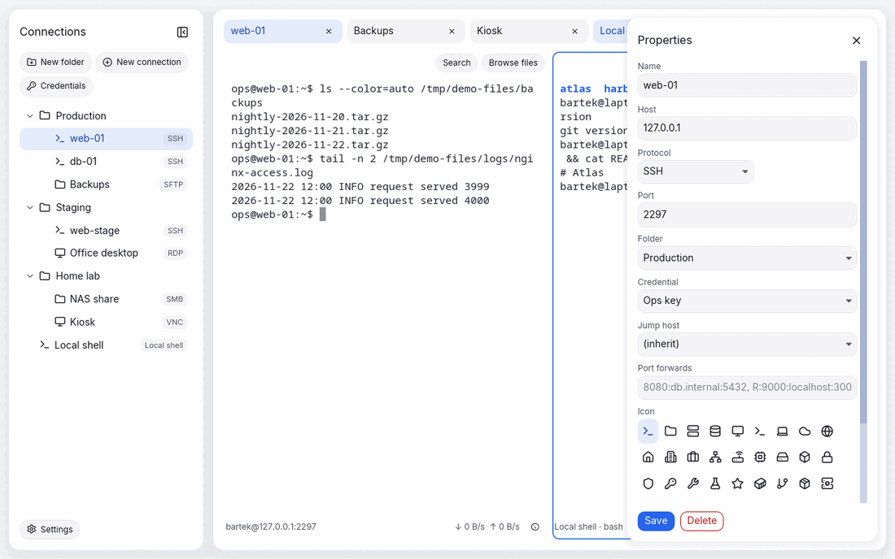

# Starting the app

```sh
remotething
```

The window has two parts: the connection tree on the left and open tabs in the centre. A properties panel floats over the right side while you edit an item.

## The tree

- Click a folder's arrow to fold or unfold it.
- Click a folder's name, or a connection, to select it.
- Double-click a connection to open it in a new tab.
- Drag the right edge of the tree to make it wider or narrower (200 to 560 pixels). The app remembers the width. Long names wrap.
- The button at the top of the tree folds it to a narrow strip; press it again to bring it back. The app remembers this. The strip keeps the buttons as icons (New folder, New connection, Credentials, Settings, with their names on hover), and pressing one unfolds the tree.
- **New folder** and **New connection** add an item inside the selected folder, or beside the selected connection. With nothing selected they go to the top level. The properties panel opens for the new item.



### Right-click menu

| Right-click on | Offers |
| --- | --- |
| Empty space | New folder, New connection (both at the top level) |
| A folder | New folder and New connection inside it, Edit, Rename, Change icon, Move up, Move down, Remove |
| A connection | Connect, Edit, Rename, Duplicate, Change icon, Move up, Move down, Remove |

- **Edit** opens the properties panel.
- **Rename** turns the name into a text field. Enter keeps the new name, Escape keeps the old one.
- **Duplicate** adds a copy of a connection right after it, named "name (copy)", and opens it for editing, so you can change just the host or the port. The copy keeps the folder, every setting and the credential; passwords are shared through that credential, not copied.
- **Change icon** shows the icon grid; the change is saved when you pick one.
- Escape or a click outside closes the menu.

### Drag and drop

Press on a folder's name or on a connection, drag, and let go:

| Dropped on | Result |
| --- | --- |
| A folder | Moves inside that folder |
| A connection | Moves into that connection's folder; a connection is placed just before it |
| Empty space | Moves to the top level |

A folder cannot be dropped into itself or into one of its own sub-folders. Folders cannot be reordered among themselves yet; they keep the order of the file.

## Tabs

| Action | How |
| --- | --- |
| New tab | **Ctrl+Shift+T**, or the **+** at the end of the tab bar. It lists your recent connections; type to search all of them, press Enter for the first match |
| Go to anything | **Ctrl+Shift+P** opens the command palette over the window. Type a few letters of a connection's name or host, or of an action (New tab, Credentials, Settings). **Up** and **Down** move, **Enter** or a click chooses, **Esc** or the same keys again close it. With nothing typed it lists your recent connections |
| Switch tabs | **Ctrl+Tab** and **Ctrl+Shift+Tab** go to the next and the previous tab, wrapping round. **Alt+1** to **Alt+8** go to that tab; **Alt+9** goes to the last one |
| List the shortcuts | **F1** shows every shortcut in a box over the window. **Esc**, **F1** or a click outside closes it. It works over a remote desktop too |
| Search the connections | **Ctrl+F** opens a search field above the connection tree. It shows connections whose name or host contains what you type, each under its folders. **Enter** opens the first match and **Esc** closes the search. In a connected terminal or a remote desktop the key belongs to that session, so use the tree's search by clicking out of it first |
| Close the tab in front | **Ctrl+Shift+W**, the **x** on the tab, or a click with the middle mouse button on the tab. **Ctrl+W** works too, except in a connected terminal, where the shell uses it to delete a word |
| Split the view | Two tabs side by side. Right-click a tab and choose **Show beside the front tab**, or press **Ctrl+Shift+S**: the next tab goes beside the front one, or a new tab if there is only one. The frame marks the pane that has the keyboard. Click the other pane, press **Ctrl+Shift+O** or click its tab in the bar to give it the keyboard (the first click only moves the keyboard). **Ctrl+Shift+S** again, or **Back to one tab** in a tab's menu, ends the split. Closing either tab ends it too. The panes keep their places. Drag the divider between them to change their sizes (each keeps at least a fifth). Double-click the divider to make them equal again. **Ctrl+Shift+R**, or **Stack the panes** in a tab's menu, puts them one above the other; the same again undoes it |
| Window size while resizing | A translucent box in the top right corner shows the window size in pixels and, with a terminal in front, its columns × lines. It goes away a moment after you stop |
| Reorder | Drag a tab onto another tab. The carried tab lifts off the bar, the tab under it is outlined, and the tab that landed glows briefly (with animations on) |
| Long titles | A title too long for its tab ends with an ellipsis; hover over the tab to see the whole title |

### Connecting without saving

Type a connection string into the search field of a new tab and press Enter. The connection opens in that tab and is not added to the tree.

| You type | Connects to |
| --- | --- |
| `ssh ops@192.168.0.1` | SSH as `ops`, port 22 |
| `ssh ops@web-01 -p 2222` or `ops@web-01:2222` | SSH on port 2222 |
| `ssh://ops@web-01:2222` | The same, as a URL |
| `rdp://desk` or `vnc://tv:5901` | RDP or VNC |

To keep it, right-click the tab and choose **Save this connection**. It is added at the top level, and the properties panel opens with name, host, protocol and port filled in. A typed user name is saved as an "ask every time" credential linked to the connection.

Right-clicking any tab also offers **Close**.

- Closing a tab with a connected session asks first. Enter closes, Escape keeps it open. Other tabs close at once.
- The recent list holds the last 20 connections and is kept in `state.toml`, beside the connections file.
- When the tabs do not fit on one line, the bar keeps one line and a **+N** button lists the rest. **Settings** can switch this to wrapping onto up to three lines, which then scroll.

## Editing

Right-click an item and choose **Edit**. Change its fields in the properties panel and press **Save**: the change is written to the connections file and the panel closes. The **X** at the top, or Escape, closes it without saving.

- **Icon** picks the icon shown in the tree. The first one in the grid is the default for that kind of item.
- Leave **Port** empty to inherit it from the folder or use the protocol's default.
- **(inherit)** for credential and jump host means the value comes from the folder above.
- **Save a password here.** While the credential is **(inherit)**, the panel has a user name and a password field. Fill them in and press **Save**: a credential named after the connection is made, the password goes to the system keyring, and the connection is linked to it. No trip to the Credentials screen. To use a credential you already have, pick it in the list instead; the fields are then hidden.
- **Delete** removes the item after asking. A folder goes with everything inside it. Closing the properties panel of a new item you never filled in or saved removes it without asking. A connection that others use as their jump host cannot be removed, and neither can a folder holding one that something outside it uses.

If a change is refused, nothing is saved, the panel stays open and the reason appears at the top of the window.

SSH connections open a terminal; see [SSH](ssh.md). RDP connections open a Windows desktop, see [Remote Desktop](rdp.md), and VNC connections open a desktop too, see [VNC](vnc.md).

## Credentials

Press **Credentials** under the tree toolbar. It opens in a tab of its own, which you switch to and close like any other. Pressing the button again goes to the tab that is already open.

- **New credential** adds one; fill in the form and press **Save**.
- **Kind** is a password, a private key (with an optional passphrase), or "ask every time".
- The password or passphrase goes to your system keyring, never to the connections file. Leave the field empty to keep the one already stored.
- Choosing "ask every time" removes any stored secret for that credential.
- A credential that a folder or connection still uses cannot be deleted. Deleting one asks first.

The keyring is Secret Service on Linux (GNOME Keyring, KWallet) and Credential Manager on Windows. If the keyring is locked, your desktop asks you to unlock it; the app waits up to a minute for that.

### Without a keyring

If no keyring is found at start-up, the app asks for a master password instead:

- The first time, choose a master password and repeat it. Your passwords are then kept in `secrets.toml`, an encrypted file beside the connections file.
- On later starts, enter the master password to unlock that file.
- **Not now** skips this; passwords you save are then kept only until you quit.

The master password is never stored. If you forget it, the file cannot be opened; delete `secrets.toml` and enter your passwords again.

The file is encrypted with XChaCha20-Poly1305 under a key derived from the master password with Argon2id.

## Settings

Press **Settings** at the bottom of the connection tree; with the tree folded it is the round cog button at the bottom of the strip. It opens in a tab like Credentials do. Changes are saved as you make them.

| Setting | Choices | Default |
| --- | --- | --- |
| Theme | Follow the system, Light, Dark, and a dark and a light variant each of Dracula, Catppuccin (Mocha, Latte), Gruvbox, Nord, Solarized and Monokai. With the optional **Follow terminal theme** feature on, also "Follow terminal theme": the window takes the colours of the terminal theme chosen on the Terminal page | Follow the system |
| Language | Follow the system, or a shipped language | Follow the system |
| When tabs do not fit on one line | Keep one line and list the rest under a button; use more lines | Keep one line |
| Interface size | 100% to 200%: draws the whole window bigger, for small text or high-resolution screens | 100% |
| Animate panels and tabs | On or off | On |
| Terminal text size, colour theme | 10 to 24 pt; imported themes, see [SSH](ssh.md) | 15 pt, follows the theme |

A theme change applies at once. A language change applies the next time you start the app. Only English is shipped so far.

The bottom of the screen shows the logo, the version and the copyright line.

Settings are kept in `settings.toml`, in the same directory as the connections file. The window size and whether it was maximized are kept there too, and restored at the next start.

### Importing PuTTY sessions

In **Settings**, press **Import from PuTTY**. The screen lists the sessions it found and what each would become; tick the ones you want and press **Import**.

| Where it looks | |
| --- | --- |
| Linux | `~/.putty/sessions`, one file per session |
| Windows | The registry key `HKEY_CURRENT_USER\Software\SimonTatham\PuTTY\Sessions`, read with `reg export` |
| Any system | **Choose a .reg file** reads a registry export, so Windows sessions can be imported on Linux |

- Sessions go into a new folder called **PuTTY**. "Default Settings" becomes that folder's default port and user name.
- Host, port and user name are carried over. Sessions with the same user and key share one credential.
- Not imported, and said so on the screen: sessions that are not SSH (telnet, serial, raw, rlogin), proxy settings and colours. Port forwards (local, remote and dynamic) are imported. A `.ppk` key file is kept as the credential's key file and used as it is.
- Passwords are never imported; PuTTY does not store them.
- PuTTY's data is only read, never changed.

### Moving connections to another copy of the app

1. In **Settings**, press **Export connections** and choose where to save the file.
2. Copy the file to the other machine.
3. There, press **Import connections** in **Settings** and pick the file. A screen lists its connections, all ticked. Untick the ones you do not want and press **Import**.

| | |
| --- | --- |
| In the file | Folders, connections, credential names, user names and key file paths, as JSON |
| Never in the file | Passwords, passphrases, the key files themselves, trusted host keys |
| What a tick brings | The connection, the folders above it, the credentials it uses and its jump hosts. Ticking everything imports the whole file, including empty folders |
| Existing items | Never changed. An imported item whose id is already taken gets a new id, and what points at it follows |

After an import, enter the passwords again on the **Credentials** screen. Importing the same file twice adds everything twice.

## Where the connections file lives

| System | Path |
| --- | --- |
| Linux | `~/.config/remotething/connections.toml` |
| Windows | `%APPDATA%\remotething\connections.toml` |

If the file does not exist, the app starts with an empty tree. If it cannot be read, the app still starts and shows the reason at the top of the window.

To use another file, for example on a USB stick:

```sh
remotething --config /path/to/connections.toml
```

The file format is described in [The connections file](connections-file.md).
